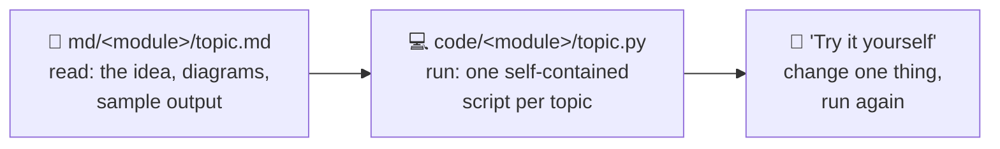
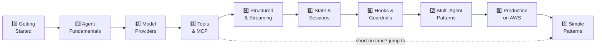
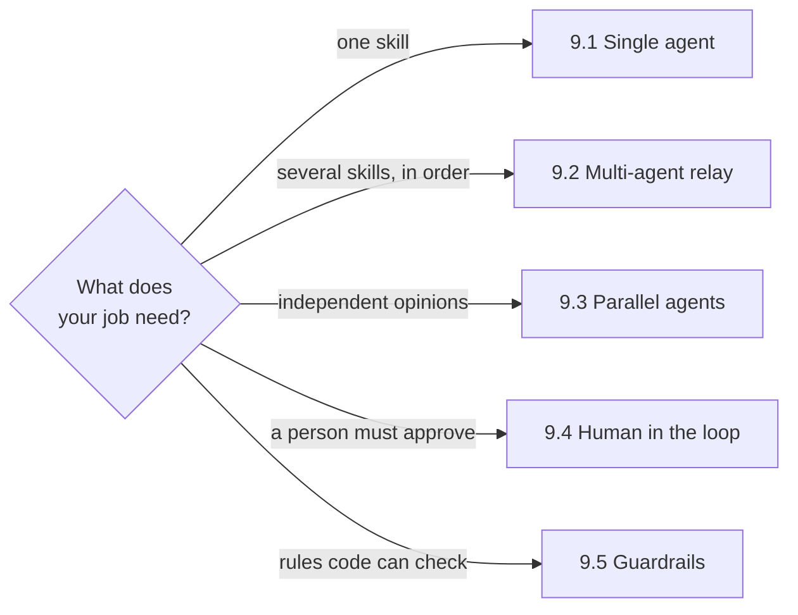

# AWS Strands Agents

A beginner-friendly, hands-on course on **AWS Strands Agents** (`strands-agents`). You don't need any prior background in AI agents. Every topic has an **explanation page** (plain English + Mermaid diagrams) and a **runnable script** (one idea, fully commented, with sample output).

---

## How this course works



- **Read** the topic page in `md/`, then **run** its matching script in `code/`.
- Every script is **self-contained**: it reads your model configuration from `settings.config` (Amazon Bedrock, OpenAI/NVIDIA, or local Ollama) and runs on its own.
- Every page has **🏠 Home · ⬅ Previous · Next ➡** links at the top and bottom.
- Start with **Module 0** to set up, then go in order. Each topic builds on the last.

```text
AWS-strands/
├── README.md                 ← you are here
├── example-settings.config   ← copy to settings.config (git-ignored)
├── requirements.txt          ← Python dependencies
├── common/                   ← optional shared config loader
├── md/                       ← explanation pages, one folder per module
│   ├── 00-getting-started/
│   ├── 01-agent-fundamentals/
│   └── ...
└── code/                     ← runnable scripts, same folders and names
    ├── 00-getting-started/
    ├── 01-agent-fundamentals/
    └── ...
```

## Learning path



> **In a hurry?** After Module 3, try **[Module 9: Simple Patterns](#module-9-simple-patterns-problems--solutions)**: five tiny problem → solution examples (single agent, multi-agent relay, parallel fan-out, human-in-the-loop, guardrails).

---

## Table of Contents

### Module 0: Getting Started

| # | Topic | Code | You'll learn |
|---|---|---|---|
| 0.1 | [Setup & Model Keys](md/00-getting-started/0_1_setup_and_keys.md) | [0_1_check_setup.py](code/00-getting-started/0_1_check_setup.py) | Install `strands-agents`, configure `settings.config`, verify everything works |
| 0.2 | [Words You Need to Know](md/00-getting-started/0_2_words_you_need_to_know.md) | [0_2_glossary_in_code.py](code/00-getting-started/0_2_glossary_in_code.py) | The 10 core concepts Strands uses everywhere, in real code |

### Module 1: Agent Fundamentals

| # | Topic | Code | You'll learn |
|---|---|---|---|
| 1.1 | [LLM vs Agent](md/01-agent-fundamentals/1_1_llm_vs_agent.md) | [1_1_llm_vs_agent.py](code/01-agent-fundamentals/1_1_llm_vs_agent.py) | Why an agent with tools beats a plain LLM call |
| 1.2 | [The Model-Driven Agent Loop](md/01-agent-fundamentals/1_2_agent_loop.md) | [1_2_agent_loop.py](code/01-agent-fundamentals/1_2_agent_loop.py) | Think → tool call → observe → respond, and how Strands runs it automatically |
| 1.3 | [System Prompts & Personas](md/01-agent-fundamentals/1_3_system_prompts.md) | [1_3_system_prompts.py](code/01-agent-fundamentals/1_3_system_prompts.py) | Steering tone, constraints, and behavior with `system_prompt` |

### Module 2: Model Providers

| # | Topic | Code | You'll learn |
|---|---|---|---|
| 2.1 | [Amazon Bedrock](md/02-model-providers/2_1_bedrock_model.md) | [2_1_bedrock_model.py](code/02-model-providers/2_1_bedrock_model.py) | `BedrockModel`, inference profiles, region, temperature, and streaming |
| 2.2 | [OpenAI, NVIDIA & Custom Endpoints](md/02-model-providers/2_2_openai_and_nvidia.md) | [2_2_openai_and_nvidia.py](code/02-model-providers/2_2_openai_and_nvidia.py) | `OpenAIModel` with `client_args` for OpenAI or any OpenAI-compatible API |
| 2.3 | [Local Models with Ollama](md/02-model-providers/2_3_ollama_local.md) | [2_3_ollama_local.py](code/02-model-providers/2_3_ollama_local.py) | `OllamaModel` for zero-cost local inference on your own machine |

### Module 3: Tools & MCP

| # | Topic | Code | You'll learn |
|---|---|---|---|
| 3.1 | [Built-in Tools](md/03-tools-and-mcp/3_1_builtin_tools.md) | [3_1_builtin_tools.py](code/03-tools-and-mcp/3_1_builtin_tools.py) | Ready-made tools from `strands_tools` (`calculator`, `current_time`, `file_read`) |
| 3.2 | [Custom `@tool` Functions](md/03-tools-and-mcp/3_2_custom_tools.md) | [3_2_custom_tools.py](code/03-tools-and-mcp/3_2_custom_tools.py) | Turning any Python function into a tool with type hints and docstrings |
| 3.3 | [Model Context Protocol (MCP)](md/03-tools-and-mcp/3_3_mcp_tools.md) | [3_3_mcp_tools.py](code/03-tools-and-mcp/3_3_mcp_tools.py) | Connecting external MCP tool servers via `MCPClient` |

### Module 4: Structured Outputs & Streaming

| # | Topic | Code | You'll learn |
|---|---|---|---|
| 4.1 | [Structured Output with Pydantic](md/04-structured-outputs-and-streaming/4_1_structured_output.md) | [4_1_structured_output.py](code/04-structured-outputs-and-streaming/4_1_structured_output.py) | Guaranteed typed schemas with `structured_output_model` |
| 4.2 | [Streaming & Async Execution](md/04-structured-outputs-and-streaming/4_2_streaming_and_async.md) | [4_2_streaming_and_async.py](code/04-structured-outputs-and-streaming/4_2_streaming_and_async.py) | Token-by-token streaming with `stream_async` and callback handlers |

### Module 5: State, Sessions & Memory

| # | Topic | Code | You'll learn |
|---|---|---|---|
| 5.1 | [Conversation Management](md/05-state-and-sessions/5_1_conversation_management.md) | [5_1_conversation_management.py](code/05-state-and-sessions/5_1_conversation_management.py) | Multi-turn context, `agent.messages`, and `SlidingWindowConversationManager` |
| 5.2 | [Persistent Sessions](md/05-state-and-sessions/5_2_session_managers.md) | [5_2_session_managers.py](code/05-state-and-sessions/5_2_session_managers.py) | Saving and resuming conversations with `FileSessionManager` and `S3SessionManager` |

### Module 6: Hooks, Guardrails & Observability

| # | Topic | Code | You'll learn |
|---|---|---|---|
| 6.1 | [Lifecycle Hooks](md/06-hooks-and-guardrails/6_1_hooks.md) | [6_1_hooks.py](code/06-hooks-and-guardrails/6_1_hooks.py) | Intercepting tool calls and model events with `HookProvider` |
| 6.2 | [Bedrock Guardrails & Safety](md/06-hooks-and-guardrails/6_2_guardrails.md) | [6_2_guardrails.py](code/06-hooks-and-guardrails/6_2_guardrails.py) | Enforcing content policies with Amazon Bedrock Guardrails and custom checks |

### Module 7: Multi-Agent Patterns

| # | Topic | Code | You'll learn |
|---|---|---|---|
| 7.1 | [Agents as Tools](md/07-multi-agent-patterns/7_1_agents_as_tools.md) | [7_1_agents_as_tools.py](code/07-multi-agent-patterns/7_1_agents_as_tools.py) | Manager-to-specialist delegation using `.as_tool()` |
| 7.2 | [Swarm (Autonomous Handoffs)](md/07-multi-agent-patterns/7_2_swarm.md) | [7_2_swarm.py](code/07-multi-agent-patterns/7_2_swarm.py) | Peer-to-peer collaboration where agents hand off work dynamically |
| 7.3 | [Graph Workflows](md/07-multi-agent-patterns/7_3_graph_workflows.md) | [7_3_graph_workflows.py](code/07-multi-agent-patterns/7_3_graph_workflows.py) | Deterministic DAGs and conditional routing with `GraphBuilder` |

### Module 8: Production & AWS Deployment

| # | Topic | Code | You'll learn |
|---|---|---|---|
| 8.1 | [AWS Lambda & API Gateway](md/08-production-and-deployment/8_1_aws_lambda_deployment.md) | [8_1_lambda_handler.py](code/08-production-and-deployment/8_1_lambda_handler.py) | Running a Strands agent inside a serverless AWS Lambda handler |
| 8.2 | [Containers & FastAPI Serving](md/08-production-and-deployment/8_2_agentcore_and_containers.md) | [8_2_fastapi_server.py](code/08-production-and-deployment/8_2_fastapi_server.py) | Exposing Strands over HTTP/SSE for containers, ECS, or Bedrock AgentCore |

### Module 9: Simple Patterns (problems & solutions)

Small, everyday problems, each solved with one pattern. Short scripts, no extras.

| # | Pattern | Code | The problem it solves |
|---|---|---|---|
| 9.1 | [Single Agent](md/09-simple-patterns/9_1_single_agent.md) | [9_1_single_agent.py](code/09-simple-patterns/9_1_single_agent.py) | Reply politely to an angry customer review |
| 9.2 | [Multi-Agent Relay](md/09-simple-patterns/9_2_multi_agent.md) | [9_2_multi_agent.py](code/09-simple-patterns/9_2_multi_agent.py) | Turn messy meeting notes into a clean team email |
| 9.3 | [Parallel Agents](md/09-simple-patterns/9_3_parallel_agents.md) | [9_3_parallel_agents.py](code/09-simple-patterns/9_3_parallel_agents.py) | Get 3 expert opinions at once, then a go / no-go |
| 9.4 | [Human in the Loop (HITL)](md/09-simple-patterns/9_4_human_in_the_loop.md) | [9_4_human_in_the_loop.py](code/09-simple-patterns/9_4_human_in_the_loop.py) | Don't send a customer email until a person approves it |
| 9.5 | [Guardrails](md/09-simple-patterns/9_5_guardrails.md) | [9_5_guardrails.py](code/09-simple-patterns/9_5_guardrails.py) | Make sure a product description is short and shows the price |



---

## Quick start

```powershell
python -m venv .venv
.venv\Scripts\pip install -r requirements.txt
```

Copy `example-settings.config` to `settings.config` in the repo root and configure one provider (Amazon Bedrock, NVIDIA NIM, OpenAI, or Ollama):

```text
AWS_REGION='us-east-1'
BEDROCK_MODEL_ID='us.amazon.nova-pro-v1:0'
```

Then run the setup check:

```powershell
.venv\Scripts\python code\00-getting-started\0_1_check_setup.py
```

Full details: [0.1 Setup & Model Keys](md/00-getting-started/0_1_setup_and_keys.md).

