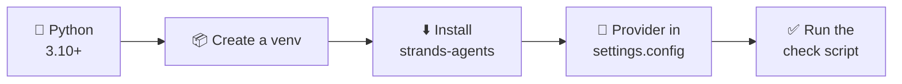
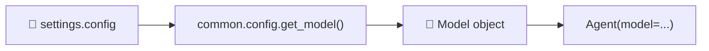

# 0.1 Setup & Model Keys

[🏠 Home](../../README.md) · [0.2 Words You Need to Know ➡](0_2_words_you_need_to_know.md)

> **Module 0 · Getting Started** · 💻 Code: [0_1_check_setup.py](../../code/00-getting-started/0_1_check_setup.py)

## In one sentence

Install Python and `strands-agents` once, configure your model provider in `settings.config`, and run one script that checks everything works.

## The setup, step by step



**1. Create a virtual environment** from the repo root:

```powershell
python -m venv .venv
```

**2. Install the packages:**

```powershell
.venv\Scripts\pip install -r requirements.txt
```

| Package | Why |
|---|---|
| `strands-agents` | Core SDK: `Agent`, `@tool`, `Swarm`, `GraphBuilder`, sessions, hooks |
| `strands-agents-tools` | Ready-made tools (`calculator`, `current_time`, `file_read`, `http_request`) |
| `boto3` | AWS SDK used by `BedrockModel` and `S3SessionManager` |
| `openai`, `mcp`, `pydantic` | OpenAI-compatible models, MCP servers, and structured outputs |

**3. Choose your model provider.** Copy `example-settings.config` to `settings.config` in the repo root (it is in `.gitignore`, so your keys never get committed):

```text
# Option A: Amazon Bedrock (uses your AWS CLI credentials)
AWS_REGION='us-east-1'
BEDROCK_MODEL_ID='us.amazon.nova-pro-v1:0'

# Option B: NVIDIA NIM / OpenAI (uncomment to use instead of Bedrock)
# NVIDIA_API_KEY='nvapi-...'
# NVIDIA_MODEL='nvidia/nemotron-3-super-120b-a12b'
```

## How every script finds the model

Every script in `code/` calls `common.config.get_model()`, which reads `settings.config` from the repo root and returns the right Strands model object (`BedrockModel`, `OpenAIModel`, or `OllamaModel`).



## Run it

```powershell
.venv\Scripts\python code\00-getting-started\0_1_check_setup.py
```

## What you'll see

```text
===== SETUP CHECK =====

  ✅ Python 3.10+           3.13.5
  ✅ strands-agents         installed
  ✅ settings.config found  C:\Code\AWS-strands\settings.config
  ✅ Model configured       BedrockModel (us.amazon.nova-pro-v1:0)
  ✅ Agent responds         'READY' in 0.9s

All good. You're ready for Module 1.
```

## Key takeaways

- Credentials and model choices live in `settings.config`, never hardcoded in scripts.
- Strands is model-agnostic: switching from Bedrock to OpenAI or Ollama only changes the `model` object.
- If this check passes, every other script in the course will run.

## Try it yourself

- Switch `BEDROCK_MODEL_ID` in `settings.config` (or uncomment `OLLAMA_MODEL`) and run the check again to compare response speed.

---

[🏠 Home](../../README.md) · [0.2 Words You Need to Know ➡](0_2_words_you_need_to_know.md)

