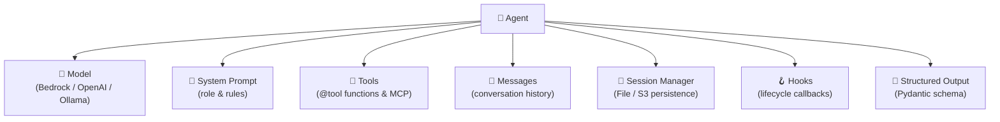

# 0.2 Words You Need to Know

[🏠 Home](../../README.md) · [⬅ 0.1 Setup & Model Keys](0_1_setup_and_keys.md) · [1.1 LLM vs Agent ➡](../01-agent-fundamentals/1_1_llm_vs_agent.md)

> **Module 0 · Getting Started** · 💻 Code: [0_2_glossary_in_code.py](../../code/00-getting-started/0_2_glossary_in_code.py)

## In one sentence

Learn the 10 core terms AWS Strands Agents uses everywhere, mapped directly to the Python classes you will write.

## The 10 words at a glance



| Term | Plain English | In Strands Code |
|---|---|---|
| **Agent** | An AI worker that thinks, calls tools, and answers | `Agent(model=..., tools=[...])` |
| **Model** | The LLM brain powering the agent | `BedrockModel`, `OpenAIModel`, `OllamaModel` |
| **System Prompt** | Standing instructions defining persona and rules | `system_prompt="You are..."` |
| **Tool** | A Python function the agent can decide to call | `@tool def my_func(...): ...` |
| **Agent Loop** | Think → call tool → observe result → repeat until done | Handled automatically by `agent(prompt)` |
| **Messages** | The running list of user, assistant, and tool turns | `agent.messages` |
| **Structured Output** | Forcing the final answer into a typed Pydantic model | `structured_output_model=MySchema` |
| **Session Manager** | Saves and reloads conversation state across runs | `FileSessionManager`, `S3SessionManager` |
| **Hook** | A callback that runs before/after model or tool calls | `HookProvider` |
| **Multi-Agent** | Multiple specialized agents collaborating | `.as_tool()`, `Swarm`, `GraphBuilder` |

## Run it

```powershell
.venv\Scripts\python code\00-getting-started\0_2_glossary_in_code.py
```

## What you'll see

```text
===== 10 STRANDS TERMS IN ACTION =====

Agent response:
The total for 3 items at $14.50 each is $43.50.

Messages recorded in agent.messages: 4
Tools available to agent: ['multiply']
```

## Key takeaways

- Strands keeps the surface area small: `Agent`, `Model`, and `@tool` cover 80% of everyday use cases.
- The **Agent Loop** is built in—you don't write `while` loops to dispatch tool calls yourself.

## Try it yourself

- Print `agent.messages` at the end of `0_2_glossary_in_code.py` to see the exact user, tool-use, tool-result, and assistant messages.

---

[🏠 Home](../../README.md) · [⬅ 0.1 Setup & Model Keys](0_1_setup_and_keys.md) · [1.1 LLM vs Agent ➡](../01-agent-fundamentals/1_1_llm_vs_agent.md)

