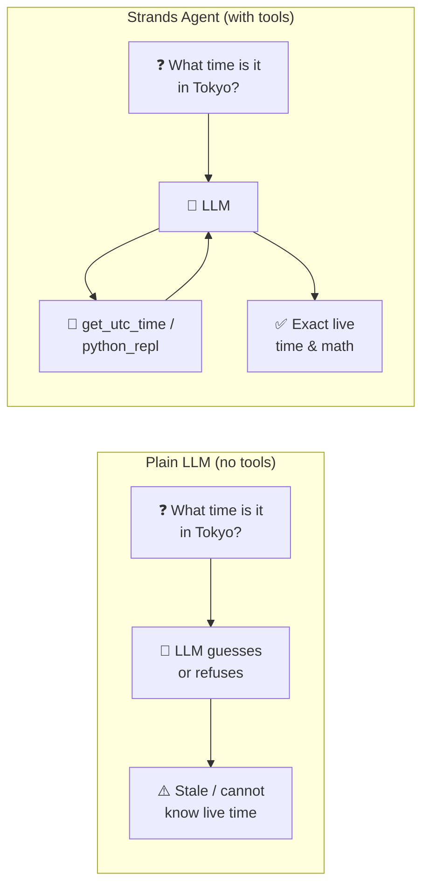

# 1.1 LLM vs Agent

[🏠 Home](../../README.md) · [⬅ 0.2 Words You Need to Know](../00-getting-started/0_2_words_you_need_to_know.md) · [1.2 The Model-Driven Agent Loop ➡](1_2_agent_loop.md)

> **Module 1 · Agent Fundamentals** · 💻 Code: [1_1_llm_vs_agent.py](../../code/01-agent-fundamentals/1_1_llm_vs_agent.py)

## In one sentence

A plain LLM can only guess from training data; an **Agent** can use tools to check live facts, compute exact numbers, and take action.

## Plain LLM vs Agent



| Dimension | Plain LLM Call | Strands Agent |
|---|---|---|
| **Knowledge** | Frozen at training cutoff | Live via tools, APIs, files, databases |
| **Math & Precision** | Predicts next token (can miscalculate) | Calls Python / calculator for exact answers |
| **Actions** | Text only | Reads files, calls APIs, writes records |
| **Execution** | Single request → single response | Loops until the goal is actually solved |

## Run it

```powershell
.venv\Scripts\python code\01-agent-fundamentals\1_1_llm_vs_agent.py
```

## What you'll see

```text
--- 1. Plain LLM (no tools) ---
I don't have access to real-time information or the current date and time...

--- 2. Strands Agent (with current_time + calculator) ---
It is currently 2026-11-17 20:18 JST in Tokyo, and 1847 * 29 = 53563.
```

## Key takeaways

- Use a **plain LLM** when you only need writing, summarizing, or brainstorming from text you already provide.
- Use a **Strands Agent** when the task needs live data, exact computation, or external systems.

## Try it yourself

- Ask both the plain agent and the tool-equipped agent to calculate `(19483 * 47) / 13` and compare accuracy.

---

[🏠 Home](../../README.md) · [⬅ 0.2 Words You Need to Know](../00-getting-started/0_2_words_you_need_to_know.md) · [1.2 The Model-Driven Agent Loop ➡](1_2_agent_loop.md)

