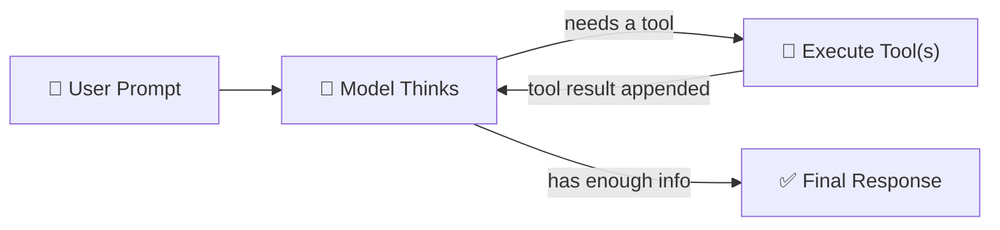

# 1.2 The Model-Driven Agent Loop

[🏠 Home](../../README.md) · [⬅ 1.1 LLM vs Agent](1_1_llm_vs_agent.md) · [1.3 System Prompts & Personas ➡](1_3_system_prompts.md)

> **Module 1 · Agent Fundamentals** · 💻 Code: [1_2_agent_loop.py](../../code/01-agent-fundamentals/1_2_agent_loop.py)

## In one sentence

Unlike rigid workflow frameworks, Strands lets the **model itself** drive the loop—deciding which tools to call, in what order, and when to stop.

## How the Strands agent loop works



1. **You call `agent(prompt)`**. Strands sends the prompt, system prompt, and tool schemas to the model.
2. **Model responds**: either with plain text (done!) or with one or more `toolUse` requests.
3. **Strands runs the tool(s)** locally in Python and appends the `toolResult` to `agent.messages`.
4. **Loop repeats** until the model produces a final answer with no more tool calls.

## Run it

```powershell
.venv\Scripts\python code\01-agent-fundamentals\1_2_agent_loop.py
```

## What you'll see

```text
Tool #1: get_order_status
Tool #2: get_refund_policy

Order #A102 is 'delivered' (5 days ago). Under the 30-day return policy, it is eligible for a full refund.

--- Loop Trace ---
Total messages in conversation: 6
```

## Key takeaways

- You never write `if tool_name == ...` dispatch logic—Strands handles the loop.
- A single prompt can trigger **multiple sequential or parallel tool calls** before returning one final answer.

## Try it yourself

- Ask about an order that is 45 days old and watch the agent call both tools and reach a different conclusion.

---

[🏠 Home](../../README.md) · [⬅ 1.1 LLM vs Agent](1_1_llm_vs_agent.md) · [1.3 System Prompts & Personas ➡](1_3_system_prompts.md)

