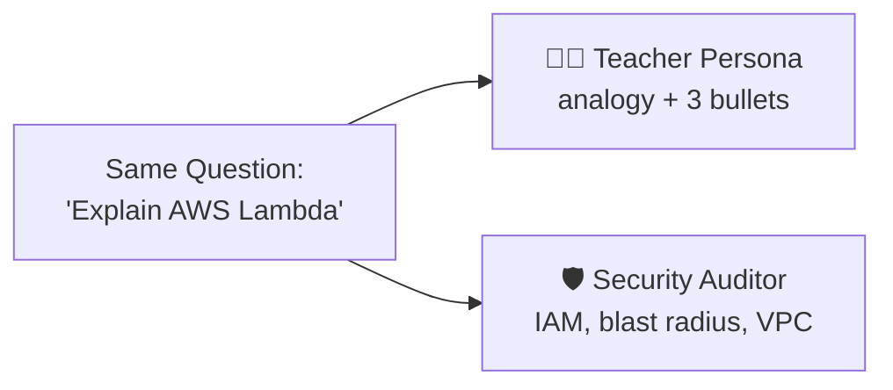

# 1.3 System Prompts & Personas

[🏠 Home](../../README.md) · [⬅ 1.2 The Model-Driven Agent Loop](1_2_agent_loop.md) · [2.1 Amazon Bedrock ➡](../02-model-providers/2_1_bedrock_model.md)

> **Module 1 · Agent Fundamentals** · 💻 Code: [1_3_system_prompts.py](../../code/01-agent-fundamentals/1_3_system_prompts.py)

## In one sentence

The `system_prompt` is the standing job description that shapes how your agent thinks, formats answers, and uses tools.

## How `system_prompt` steers behavior



Good system prompts include:
1. **Role:** Who the agent is (`"You are a senior AWS solutions architect"`).
2. **Rules / Guardrails:** What it must or must not do (`"Never invent pricing; cite exact limits"`).
3. **Output format:** How to structure the reply (`"Respond in 3 concise bullet points"`).

## Run it

```powershell
.venv\Scripts\python code\01-agent-fundamentals\1_3_system_prompts.py
```

## What you'll see

```text
--- Teacher Persona ---
Think of AWS Lambda like a taxi instead of owning a car...

--- Security Auditor Persona ---
- Least-privilege IAM execution role per function
- Avoid embedding secrets in environment variables; use Secrets Manager...
```

## Key takeaways

- Keep `system_prompt` clear, specific, and concise.
- Changing the `system_prompt` alone can turn the exact same model into completely different specialists.

## Try it yourself

- Add a third persona (e.g., `"FinOps Cost Optimizer"`) and pass the same question.

---

[🏠 Home](../../README.md) · [⬅ 1.2 The Model-Driven Agent Loop](1_2_agent_loop.md) · [2.1 Amazon Bedrock ➡](../02-model-providers/2_1_bedrock_model.md)

