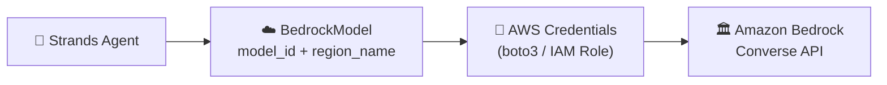

# 2.1 Amazon Bedrock

[🏠 Home](../../README.md) · [⬅ 1.3 System Prompts & Personas](../01-agent-fundamentals/1_3_system_prompts.md) · [2.2 OpenAI, NVIDIA & Custom Endpoints ➡](2_2_openai_and_nvidia.md)

> **Module 2 · Model Providers** · 💻 Code: [2_1_bedrock_model.py](../../code/02-model-providers/2_1_bedrock_model.py)

## In one sentence

`BedrockModel` connects your Strands agent directly to Amazon Bedrock foundation models (Amazon Nova, Anthropic Claude, Meta Llama) using your AWS credentials.

## How BedrockModel works



Key parameters you can tune:
- `model_id`: e.g. `us.amazon.nova-pro-v1:0` or `us.anthropic.claude-3-7-sonnet-20250219-v1:0` (cross-region inference profile IDs start with `us.` or `eu.`).
- `region_name`: AWS region where the model or inference profile is enabled.
- `temperature`: `0.0` for deterministic/factual tasks, `0.7` for creative writing.
- `streaming`: `True` (default) for real-time token streaming via Bedrock's `ConverseStream` API.

## Run it

```powershell
.venv\Scripts\python code\02-model-providers\2_1_bedrock_model.py
```

## What you'll see

```text
Using BedrockModel: us.amazon.nova-pro-v1:0 in us-east-1
Amazon Bedrock is a fully managed service...
```

## Key takeaways

- `BedrockModel` is the default provider in AWS Strands—if you omit `model=` in `Agent()`, Strands uses Bedrock automatically.
- Use IAM roles in production (Lambda/ECS/EC2) and `aws configure` locally—no static API keys required.

## Try it yourself

- Change `temperature=0.0` vs `temperature=0.9` and ask the agent to invent a product tagline twice.

---

[🏠 Home](../../README.md) · [⬅ 1.3 System Prompts & Personas](../01-agent-fundamentals/1_3_system_prompts.md) · [2.2 OpenAI, NVIDIA & Custom Endpoints ➡](2_2_openai_and_nvidia.md)

