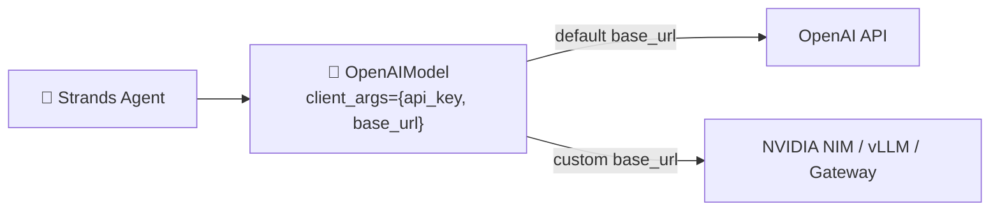

# 2.2 OpenAI, NVIDIA & Custom Endpoints

[🏠 Home](../../README.md) · [⬅ 2.1 Amazon Bedrock](2_1_bedrock_model.md) · [2.3 Local Models with Ollama ➡](2_3_ollama_local.md)

> **Module 2 · Model Providers** · 💻 Code: [2_2_openai_and_nvidia.py](../../code/02-model-providers/2_2_openai_and_nvidia.py)

## In one sentence

Use `OpenAIModel` with `client_args` to point a Strands agent at OpenAI or any OpenAI-compatible gateway (NVIDIA NIM, vLLM, Groq, Together, LiteLLM).

## How OpenAIModel routes requests



## Run it

```powershell
.venv\Scripts\python code\02-model-providers\2_2_openai_and_nvidia.py
```

## What you'll see

```text
Using OpenAIModel: nvidia/nemotron-3-super-120b-a12b
Strands Agents is model-agnostic...
```

## Key takeaways

- Pass `api_key` and optional `base_url` inside `client_args={...}` on `OpenAIModel`.
- Your tools, prompts, and multi-agent code stay **100% identical** across providers.

## Try it yourself

- Swap `model_id` in `settings.config` to another OpenAI-compatible model and run again without touching the agent code.

---

[🏠 Home](../../README.md) · [⬅ 2.1 Amazon Bedrock](2_1_bedrock_model.md) · [2.3 Local Models with Ollama ➡](2_3_ollama_local.md)

