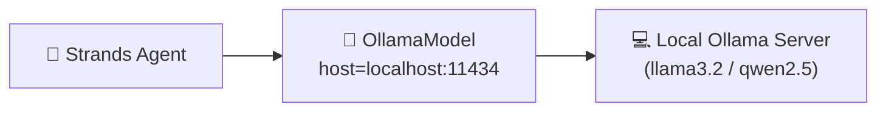

# 2.3 Local Models with Ollama

[🏠 Home](../../README.md) · [⬅ 2.2 OpenAI, NVIDIA & Custom Endpoints](2_2_openai_and_nvidia.md) · [3.1 Built-in Tools ➡](../03-tools-and-mcp/3_1_builtin_tools.md)

> **Module 2 · Model Providers** · 💻 Code: [2_3_ollama_local.py](../../code/02-model-providers/2_3_ollama_local.py)

## In one sentence

`OllamaModel` lets you run Strands agents completely offline on your laptop with zero API cost.

## Local inference flow



Before running:
1. Install Ollama from <https://ollama.com>.
2. Pull a tool-capable model: `ollama pull llama3.2`.
3. Ensure `ollama serve` is running.

## Run it

```powershell
.venv\Scripts\python code\02-model-providers\2_3_ollama_local.py
```

## What you'll see

```text
Using OllamaModel: llama3.2 at http://localhost:11434
Local agents keep data on your machine and cost $0 per token.
```

## Key takeaways

- Local models are ideal for rapid prototyping, offline work, and sensitive data.
- For reliable tool calling with Ollama, pick models trained for tool use (such as `llama3.2` or `qwen2.5`).

## Try it yourself

- Attach `@tool` functions to the `OllamaModel` agent and test local tool calling.

---

[🏠 Home](../../README.md) · [⬅ 2.2 OpenAI, NVIDIA & Custom Endpoints](2_2_openai_and_nvidia.md) · [3.1 Built-in Tools ➡](../03-tools-and-mcp/3_1_builtin_tools.md)

