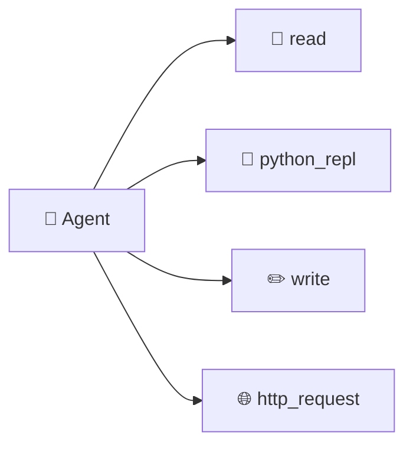

# 3.1 Built-in Tools

[🏠 Home](../../README.md) · [⬅ 2.3 Local Models with Ollama](../02-model-providers/2_3_ollama_local.md) · [3.2 Custom @tool Functions ➡](3_2_custom_tools.md)

> **Module 3 · Tools & MCP** · 💻 Code: [3_1_builtin_tools.py](../../code/03-tools-and-mcp/3_1_builtin_tools.py)

## In one sentence

`strands.vended_tools` gives you ready-to-use tools—like `read`, `write`, `python_repl`, `shell`, and `http_request`—so you don't reinvent the basics.

## Common built-in tools

| Tool | What it does |
|---|---|
| `read` | Reads local files safely |
| `write` / `file_editor` | Creates or edits local files |
| `python_repl` | Executes Python code for exact math and data work |
| `http_request` | Makes HTTP calls to external APIs |



## Run it

```powershell
.venv\Scripts\python code\03-tools-and-mcp\3_1_builtin_tools.py
```

## What you'll see

```text
Tool #1: read
Tool #2: python_repl
requirements.txt lists 9 packages. 84.60 * 1.15 = 97.29.
```

## Key takeaways

- Import pre-built tools directly from `strands.vended_tools` and pass them in `tools=[...]`.
- Only give an agent the tools it actually needs—fewer tools mean faster, more accurate tool selection.

## Try it yourself

- Ask the agent to read `README.md` using `read` and summarize it in 3 bullets.

---

[🏠 Home](../../README.md) · [⬅ 2.3 Local Models with Ollama](../02-model-providers/2_3_ollama_local.md) · [3.2 Custom @tool Functions ➡](3_2_custom_tools.md)

