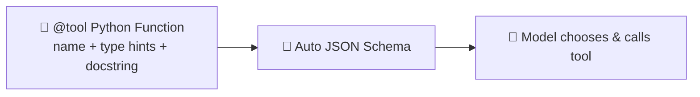

# 3.2 Custom `@tool` Functions

[🏠 Home](../../README.md) · [⬅ 3.1 Built-in Tools](3_1_builtin_tools.md) · [3.3 Model Context Protocol (MCP) ➡](3_3_mcp_tools.md)

> **Module 3 · Tools & MCP** · 💻 Code: [3_2_custom_tools.py](../../code/03-tools-and-mcp/3_2_custom_tools.py)

## In one sentence

Decorate any Python function with `@tool`, add type hints and a clear docstring, and Strands automatically turns it into a schema the LLM can call.

## Anatomy of a good `@tool`



```python
@tool
def lookup_inventory(sku: str) -> dict:
    """Check stock count and warehouse location for a product SKU.

    Args:
        sku: Product SKU code, e.g. 'WIDGET-01'.
    """
    ...
```

Strands inspects three things:
1. **Function name** → tool name (`lookup_inventory`).
2. **Type hints** (`sku: str`) → JSON schema parameter types.
3. **Docstring & `Args:`** → tells the LLM *when* to call the tool and what each argument means.

## Run it

```powershell
.venv\Scripts\python code\03-tools-and-mcp\3_2_custom_tools.py
```

## What you'll see

```text
Tool #1: lookup_inventory
Tool #2: reserve_stock
Reserved 3 units of WIDGET-01. Remaining stock: 12.
```

## Key takeaways

- Clear docstrings and type hints are how you "prompt" the model to use your tool properly.
- Return structured dicts or clear error messages—if a tool raises or returns an error string, the agent can recover gracefully.

## Try it yourself

- Ask the agent to reserve 500 units of `WIDGET-01` and see how it handles the insufficient-stock message.

---

[🏠 Home](../../README.md) · [⬅ 3.1 Built-in Tools](3_1_builtin_tools.md) · [3.3 Model Context Protocol (MCP) ➡](3_3_mcp_tools.md)

