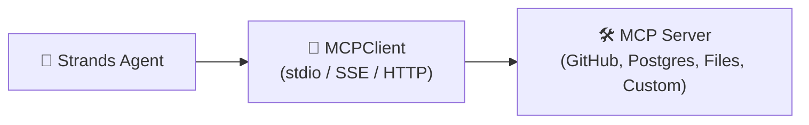

# 3.3 Model Context Protocol (MCP)

[🏠 Home](../../README.md) · [⬅ 3.2 Custom @tool Functions](3_2_custom_tools.md) · [4.1 Structured Output with Pydantic ➡](../04-structured-outputs-and-streaming/4_1_structured_output.md)

> **Module 3 · Tools & MCP** · 💻 Code: [3_3_mcp_tools.py](../../code/03-tools-and-mcp/3_3_mcp_tools.py)

## In one sentence

`MCPClient` connects your Strands agent to any external **Model Context Protocol (MCP)** server so it can discover and call remote or local tools without custom glue code.

## How MCPClient works



1. Open the connection with `with mcp_client:`.
2. Call `mcp_client.list_tools_sync()` to fetch the server's tools.
3. Pass those tools directly into `Agent(tools=...)`.

## Run it

```powershell
.venv\Scripts\python code\03-tools-and-mcp\3_3_mcp_tools.py
```

## What you'll see

```text
Discovered MCP tools: ['echo_upper', 'word_count']
Tool #1: word_count
The sentence has 7 words.
```

## Key takeaways

- MCP standardizes tool discovery so one server works across Strands, IDEs, and other clients.
- Always keep the `Agent` call **inside** the `with mcp_client:` block so the transport stays open while tools execute.

## Try it yourself

- Point `stdio_client` at another local MCP server (like `@modelcontextprotocol/server-filesystem`) and list its tools.

---

[🏠 Home](../../README.md) · [⬅ 3.2 Custom @tool Functions](3_2_custom_tools.md) · [4.1 Structured Output with Pydantic ➡](../04-structured-outputs-and-streaming/4_1_structured_output.md)

