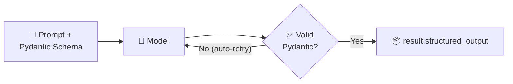

# 4.1 Structured Output with Pydantic

[🏠 Home](../../README.md) · [⬅ 3.3 Model Context Protocol (MCP)](../03-tools-and-mcp/3_3_mcp_tools.md) · [4.2 Streaming & Async Execution ➡](4_2_streaming_and_async.md)

> **Module 4 · Structured Outputs & Streaming** · 💻 Code: [4_1_structured_output.py](../../code/04-structured-outputs-and-streaming/4_1_structured_output.py)

## In one sentence

Pass a Pydantic `BaseModel` via `structured_output_model` so your agent returns a validated Python object instead of unpredictable free-form text.

## How Strands guarantees the schema



Under the hood, Strands turns your Pydantic class into a tool schema, validates the model's output, and automatically feeds any validation errors back to the model to self-correct.

## Run it

```powershell
.venv\Scripts\python code\04-structured-outputs-and-streaming\4_1_structured_output.py
```

## What you'll see

```text
Category : billing
Priority : high
Summary  : Customer was charged twice for their monthly subscription.
```

## Key takeaways

- Use `structured_output_model=MySchema` whenever downstream code needs reliable fields (`category`, `priority`, `items`, etc.).
- Access the parsed object via `result.structured_output`.

## Try it yourself

- Add a `suggested_reply: str` field to `TicketTriage` with a `Field(description=...)` and re-run.

---

[🏠 Home](../../README.md) · [⬅ 3.3 Model Context Protocol (MCP)](../03-tools-and-mcp/3_3_mcp_tools.md) · [4.2 Streaming & Async Execution ➡](4_2_streaming_and_async.md)

