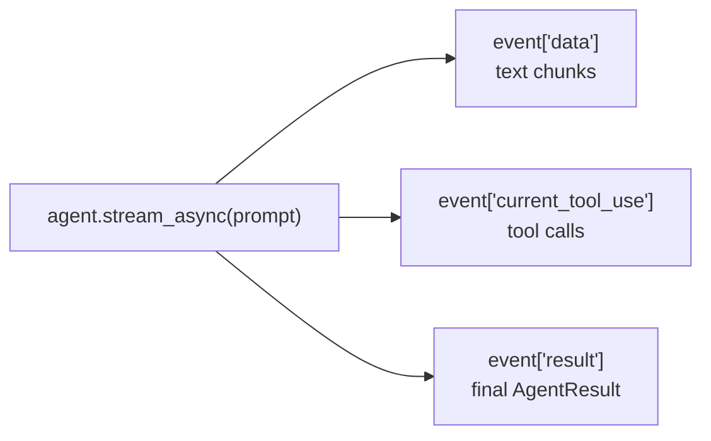

# 4.2 Streaming & Async Execution

[🏠 Home](../../README.md) · [⬅ 4.1 Structured Output with Pydantic](4_1_structured_output.md) · [5.1 Conversation Management ➡](../05-state-and-sessions/5_1_conversation_management.md)

> **Module 4 · Structured Outputs & Streaming** · 💻 Code: [4_2_streaming_and_async.py](../../code/04-structured-outputs-and-streaming/4_2_streaming_and_async.py)

## In one sentence

Use `agent.stream_async(...)` to receive tokens, tool-use events, and the final result in real time instead of waiting for the entire response.

## Streaming events in Strands



- **Sync `agent(prompt)`**: blocks until the whole answer is ready (default callback prints to stdout).
- **Async `agent.stream_async(prompt)`**: yields dictionaries as tokens arrive—ideal for FastAPI/SSE, WebSockets, or CLI spinners.

## Run it

```powershell
.venv\Scripts\python code\04-structured-outputs-and-streaming\4_2_streaming_and_async.py
```

## What you'll see

```text
Streaming response:
Strands streams tokens as soon as the model generates them...

[Done] Received 28 text chunks.
```

## Key takeaways

- Set `callback_handler=None` when consuming `stream_async()` yourself so output isn't printed twice.
- `stream_async()` is the standard way to power responsive chat UIs and APIs.

## Try it yourself

- Add a `@tool` to the agent and print `event["current_tool_use"]["name"]` whenever a tool event arrives in the stream.

---

[🏠 Home](../../README.md) · [⬅ 4.1 Structured Output with Pydantic](4_1_structured_output.md) · [5.1 Conversation Management ➡](../05-state-and-sessions/5_1_conversation_management.md)

