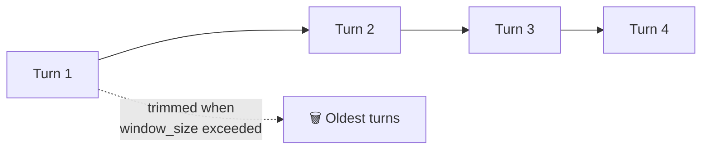

# 5.1 Conversation Management

[🏠 Home](../../README.md) · [⬅ 4.2 Streaming & Async Execution](../04-structured-outputs-and-streaming/4_2_streaming_and_async.md) · [5.2 Persistent Sessions ➡](5_2_session_managers.md)

> **Module 5 · State, Sessions & Memory** · 💻 Code: [5_1_conversation_management.py](../../code/05-state-and-sessions/5_1_conversation_management.py)

## In one sentence

A Strands `Agent` remembers earlier turns in `agent.messages`, and `SlidingWindowConversationManager` keeps that history from overflowing the model's context window.

## How conversation history is managed



- Every call to `agent(...)` appends to `agent.messages`.
- Long chats eventually hit token limits; `SlidingWindowConversationManager(window_size=...)` automatically trims older messages while keeping valid tool-call/tool-result pairs intact.

## Run it

```powershell
.venv\Scripts\python code\05-state-and-sessions\5_1_conversation_management.py
```

## What you'll see

```text
Turn 1: Nice to meet you, Akhila!
Turn 2: You mentioned you are building agents on AWS.
Messages stored (window_size=4): 4
```

## Key takeaways

- An `Agent` instance is stateful in memory across calls.
- Use `SlidingWindowConversationManager` in long-running chats to bound token cost and latency.

## Try it yourself

- Set `window_size=2`, run 4 turns, and see which earlier facts get trimmed.

---

[🏠 Home](../../README.md) · [⬅ 4.2 Streaming & Async Execution](../04-structured-outputs-and-streaming/4_2_streaming_and_async.md) · [5.2 Persistent Sessions ➡](5_2_session_managers.md)

