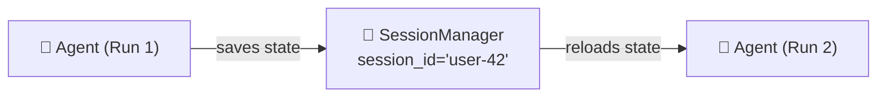

# 5.2 Persistent Sessions

[🏠 Home](../../README.md) · [⬅ 5.1 Conversation Management](5_1_conversation_management.md) · [6.1 Lifecycle Hooks ➡](../06-hooks-and-guardrails/6_1_hooks.md)

> **Module 5 · State, Sessions & Memory** · 💻 Code: [5_2_session_managers.py](../../code/05-state-and-sessions/5_2_session_managers.py)

## In one sentence

`FileSessionManager` and `S3SessionManager` save conversation history to disk or Amazon S3 so an agent can resume seamlessly across restarts or serverless invocations.

## Local vs Cloud Session Persistence



- **`FileSessionManager(session_id=..., storage_dir=...)`**: stores JSON files locally—great for development and CLI tools.
- **`S3SessionManager(session_id=..., bucket=...)`**: stores sessions in Amazon S3—ideal for AWS Lambda and ECS containers.

## Run it

```powershell
.venv\Scripts\python code\05-state-and-sessions\5_2_session_managers.py
```

## What you'll see

```text
--- Run 1 (new agent) ---
Got it! I'll remember your preferred region is us-west-2.

--- Run 2 (brand new Agent instance, same session_id) ---
Your preferred AWS region is us-west-2.
```

## Key takeaways

- Two completely separate `Agent` instances sharing the same `session_id` share the exact same memory.
- Swap `FileSessionManager` for `S3SessionManager` when deploying to AWS Lambda or ECS.

## Try it yourself

- Run the script twice and verify the second run still remembers `us-west-2` from the saved `.strands/sessions` folder.

---

[🏠 Home](../../README.md) · [⬅ 5.1 Conversation Management](5_1_conversation_management.md) · [6.1 Lifecycle Hooks ➡](../06-hooks-and-guardrails/6_1_hooks.md)

