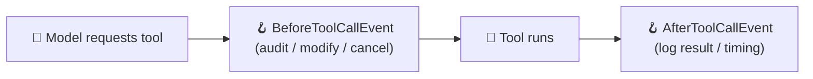

# 6.1 Lifecycle Hooks

[🏠 Home](../../README.md) · [⬅ 5.2 Persistent Sessions](../05-state-and-sessions/5_2_session_managers.md) · [6.2 Bedrock Guardrails & Safety ➡](6_2_guardrails.md)

> **Module 6 · Hooks, Guardrails & Observability** · 💻 Code: [6_1_hooks.py](../../code/06-hooks-and-guardrails/6_1_hooks.py)

## In one sentence

`HookProvider` lets you intercept key lifecycle events—like `BeforeToolCallEvent` and `AfterToolCallEvent`—for auditing, metrics, or blocking unsafe actions without touching tool code.

## Hook lifecycle



## Run it

```powershell
.venv\Scripts\python code\06-hooks-and-guardrails\6_1_hooks.py
```

## What you'll see

```text
[HOOK before] tool=get_account_balance input={'account_id': 'ACC-100'}
[HOOK after]  tool=get_account_balance completed
Your balance for ACC-100 is $1,250.00.
```

## Key takeaways

- Hooks decouple cross-cutting concerns (logging, telemetry, access checks) from business logic.
- Register callbacks inside `register_hooks(self, registry: HookRegistry, **kwargs)` using `registry.add_callback(...)`.

## Try it yourself

- Add a `BeforeInvocationEvent` or `AfterInvocationEvent` callback to measure total request duration.

---

[🏠 Home](../../README.md) · [⬅ 5.2 Persistent Sessions](../05-state-and-sessions/5_2_session_managers.md) · [6.2 Bedrock Guardrails & Safety ➡](6_2_guardrails.md)

