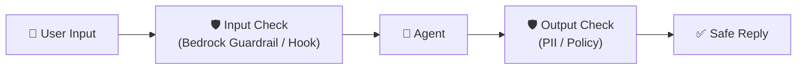

# 6.2 Bedrock Guardrails & Safety

[🏠 Home](../../README.md) · [⬅ 6.1 Lifecycle Hooks](6_1_hooks.md) · [7.1 Agents as Tools ➡](../07-multi-agent-patterns/7_1_agents_as_tools.md)

> **Module 6 · Hooks, Guardrails & Observability** · 💻 Code: [6_2_guardrails.py](../../code/06-hooks-and-guardrails/6_2_guardrails.py)

## In one sentence

Protect your agents against PII leaks, off-topic prompts, and unsafe outputs using **Amazon Bedrock Guardrails** or deterministic Python validation hooks.

## Two layers of guardrails



1. **Amazon Bedrock Guardrails** (`guardrail_id`, `guardrail_version` on `BedrockModel`): AWS-managed content filtering, denied topics, PII redaction, and prompt-attack protection.
2. **Code-level Guardrails**: deterministic Python checks (regex, word count, PII patterns) that run on every response regardless of model provider.

## Run it

```powershell
.venv\Scripts\python code\06-hooks-and-guardrails\6_2_guardrails.py
```

## What you'll see

```text
--- Safe prompt ---
AWS S3 is an object storage service...

--- Blocked PII output check ---
[BLOCKED] Response contained an email/SSN pattern and was redacted.
```

## Key takeaways

- Combine **LLM-level guardrails** (Bedrock Guardrails) with **deterministic code checks** for defense in depth.
- If you have a Bedrock Guardrail ID in `settings.config` (`BEDROCK_GUARDRAIL_ID`), pass it directly to `BedrockModel(...)`.

## Try it yourself

- Add a rule to `enforce_safe_output()` that blocks competitor names or enforces a maximum character length.

---

[🏠 Home](../../README.md) · [⬅ 6.1 Lifecycle Hooks](6_1_hooks.md) · [7.1 Agents as Tools ➡](../07-multi-agent-patterns/7_1_agents_as_tools.md)

