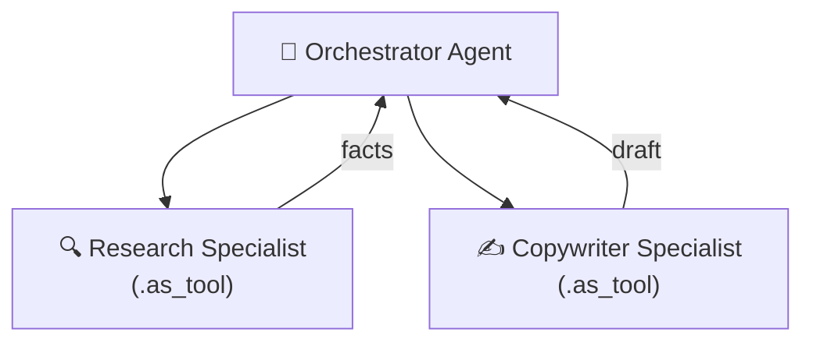

# 7.1 Agents as Tools

[🏠 Home](../../README.md) · [⬅ 6.2 Bedrock Guardrails & Safety](../06-hooks-and-guardrails/6_2_guardrails.md) · [7.2 Swarm (Autonomous Handoffs) ➡](7_2_swarm.md)

> **Module 7 · Multi-Agent Patterns** · 💻 Code: [7_1_agents_as_tools.py](../../code/07-multi-agent-patterns/7_1_agents_as_tools.py)

## In one sentence

Wrap specialized `Agent` instances as tools (via `@tool` or `.as_tool()`) so a central **orchestrator agent** can delegate subtasks and synthesize one final answer.

## Hierarchical delegation



- **When to use it:** You have a clear manager/worker structure where one coordinator decides which specialists to consult.
- Each specialist has its own focused `system_prompt` and `tools`, keeping contexts small and clean.

## Run it

```powershell
.venv\Scripts\python code\07-multi-agent-patterns\7_1_agents_as_tools.py
```

## What you'll see

```text
Tool #1: researcher
Tool #2: copywriter
Here is your launch announcement for Amazon Bedrock Nova...
```

## Key takeaways

- "Agents as tools" is the simplest multi-agent pattern in Strands—it's just regular tool calling!
- Specialists don't pollute the orchestrator's message history with their internal reasoning.

## Try it yourself

- Add a `translator` specialist tool that translates the final announcement into Spanish.

---

[🏠 Home](../../README.md) · [⬅ 6.2 Bedrock Guardrails & Safety](../06-hooks-and-guardrails/6_2_guardrails.md) · [7.2 Swarm (Autonomous Handoffs) ➡](7_2_swarm.md)

