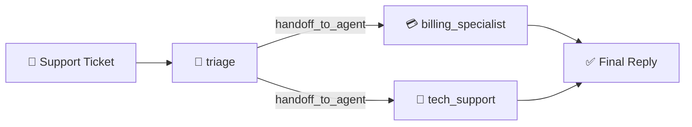

# 7.2 Swarm (Autonomous Handoffs)

[🏠 Home](../../README.md) · [⬅ 7.1 Agents as Tools](7_1_agents_as_tools.md) · [7.3 Graph Workflows ➡](7_3_graph_workflows.md)

> **Module 7 · Multi-Agent Patterns** · 💻 Code: [7_2_swarm.py](../../code/07-multi-agent-patterns/7_2_swarm.py)

## In one sentence

A `Swarm` is a team of peer agents that share context and **autonomously hand off** control to whichever specialist should act next—no hardcoded flowchart required.

## How a Swarm collaborates



- **When to use it:** Open-ended triage, debugging, or collaborative workflows where the path isn't known upfront.
- Any agent in the swarm can hand off to another named agent, and the swarm stops when an agent answers without handing off.

## Run it

```powershell
.venv\Scripts\python code\07-multi-agent-patterns\7_2_swarm.py
```

## What you'll see

```text
Swarm status: COMPLETED
Agents involved: ['triage', 'tech_support']
Final result: Restarting the worker pool clears the connection leak...
```

## Key takeaways

- Give each `Agent` in a `Swarm` a distinct `name` and `system_prompt` describing what it handles.
- Set `max_handoffs` to prevent infinite ping-ponging between peers.

## Try it yourself

- Send a billing question (`"I was double-charged on invoice #44"`) and watch `triage` route to `billing_specialist` instead.

---

[🏠 Home](../../README.md) · [⬅ 7.1 Agents as Tools](7_1_agents_as_tools.md) · [7.3 Graph Workflows ➡](7_3_graph_workflows.md)

