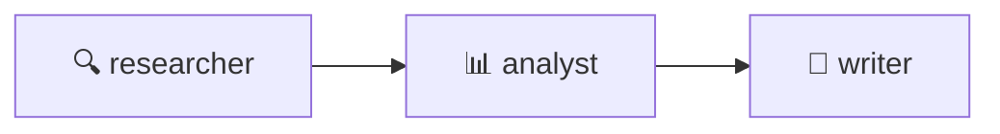

# 7.3 Graph Workflows

[🏠 Home](../../README.md) · [⬅ 7.2 Swarm (Autonomous Handoffs)](7_2_swarm.md) · [8.1 AWS Lambda & API Gateway ➡](../08-production-and-deployment/8_1_aws_lambda_deployment.md)

> **Module 7 · Multi-Agent Patterns** · 💻 Code: [7_3_graph_workflows.py](../../code/07-multi-agent-patterns/7_3_graph_workflows.py)

## In one sentence

`GraphBuilder` lets you wire agents into a **deterministic directed graph** (pipelines, fan-out/fan-in, and conditional branches) when execution order must be predictable.

## Swarm vs Graph

| Pattern | Control | Best For |
|---|---|---|
| **Swarm** | Model decides who goes next | Dynamic triage, open-ended investigation |
| **Graph (`GraphBuilder`)** | Developer defines nodes & edges | Repeatable pipelines, compliance, QA gates |



## Run it

```powershell
.venv\Scripts\python code\07-multi-agent-patterns\7_3_graph_workflows.py
```

## What you'll see

```text
Graph status: COMPLETED
Execution order: ['researcher', 'analyst', 'writer']
Final report: ...
```

## Key takeaways

- Use `GraphBuilder().add_node(agent, "id").add_edge("a", "b").set_entry_point("a").build()`.
- Each node receives the upstream node's output automatically as context.

## Try it yourself

- Add a `reviewer` node after `writer` or add a second parallel branch from `researcher`.

---

[🏠 Home](../../README.md) · [⬅ 7.2 Swarm (Autonomous Handoffs)](7_2_swarm.md) · [8.1 AWS Lambda & API Gateway ➡](../08-production-and-deployment/8_1_aws_lambda_deployment.md)

