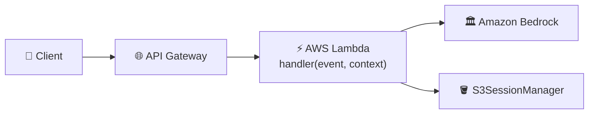

# 8.1 AWS Lambda & API Gateway

[🏠 Home](../../README.md) · [⬅ 7.3 Graph Workflows](../07-multi-agent-patterns/7_3_graph_workflows.md) · [8.2 Containers & FastAPI Serving ➡](8_2_agentcore_and_containers.md)

> **Module 8 · Production & AWS Deployment** · 💻 Code: [8_1_lambda_handler.py](../../code/08-production-and-deployment/8_1_lambda_handler.py)

## In one sentence

Package a Strands agent inside an AWS Lambda handler, initialize the `Agent` outside `handler()` for warm starts, and pair it with `S3SessionManager` for stateless scaling.

## Serverless architecture on AWS



Production tips for AWS Lambda:
1. **Warm-start reuse:** Instantiate `BedrockModel` and `tools` at module scope (outside `lambda_handler`).
2. **IAM role:** Grant `bedrock:InvokeModel` and `bedrock:InvokeModelWithResponseStream` (plus `s3:GetObject`/`s3:PutObject` if using `S3SessionManager`).
3. **Timeout & memory:** Set Lambda timeout to at least `60s` and memory to `512 MB+`.

## Run it (local Lambda simulation)

```powershell
.venv\Scripts\python code\08-production-and-deployment\8_1_lambda_handler.py
```

## What you'll see

```text
Simulated API Gateway Response:
Status: 200
Body: {"session_id": "req-101", "answer": "Amazon S3 is..."}
```

## Key takeaways

- Strands runs cleanly in AWS Lambda with zero server management.
- You can test your `lambda_handler(event, context)` locally before deploying with SAM, CDK, or Terraform.

## Try it yourself

- Wire `S3SessionManager` into `lambda_handler` using an S3 bucket name from `os.environ["SESSION_BUCKET"]`.

---

[🏠 Home](../../README.md) · [⬅ 7.3 Graph Workflows](../07-multi-agent-patterns/7_3_graph_workflows.md) · [8.2 Containers & FastAPI Serving ➡](8_2_agentcore_and_containers.md)

