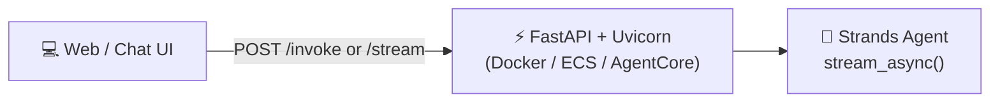

# 8.2 Containers & FastAPI Serving

[🏠 Home](../../README.md) · [⬅ 8.1 AWS Lambda & API Gateway](8_1_aws_lambda_deployment.md) · [9.1 Single Agent ➡](../09-simple-patterns/9_1_single_agent.md)

> **Module 8 · Production & AWS Deployment** · 💻 Code: [8_2_fastapi_server.py](../../code/08-production-and-deployment/8_2_fastapi_server.py)

## In one sentence

Serve a Strands agent behind **FastAPI** with Server-Sent Events (SSE) streaming for long-running tasks on ECS, EKS, or **Amazon Bedrock AgentCore Runtime**.

## Container serving architecture



## Run it

```powershell
.venv\Scripts\uvicorn code.08-production-and-deployment.8_2_fastapi_server:app --reload
```

Or run a quick self-test without starting the server:

```powershell
.venv\Scripts\python code\08-production-and-deployment\8_2_fastapi_server.py
```

## What you'll see

```text
POST /invoke -> {"response": "AWS Strands Agents is..."}
```

## Key takeaways

- FastAPI + `agent.stream_async()` gives you production HTTP + SSE streaming in ~30 lines.
- Containerizing with Docker lets you deploy identically to local dev, AWS ECS Fargate, EKS, or Bedrock AgentCore.

## Try it yourself

- Start the Uvicorn server and call `POST http://127.0.0.1:8000/invoke` with `{"prompt": "Hello!"}` or `POST /stream` for live SSE chunks.

---

[🏠 Home](../../README.md) · [⬅ 8.1 AWS Lambda & API Gateway](8_1_aws_lambda_deployment.md) · [9.1 Single Agent ➡](../09-simple-patterns/9_1_single_agent.md)

