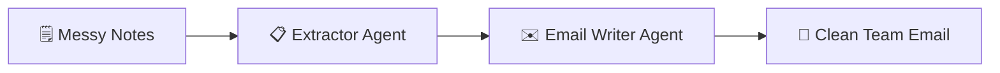

# 9.2 Multi-Agent Relay

[🏠 Home](../../README.md) · [⬅ 9.1 Single Agent](9_1_single_agent.md) · [9.3 Parallel Agents ➡](9_3_parallel_agents.md)

> **Module 9 · Simple Patterns** · 💻 Code: [9_2_multi_agent.py](../../code/09-simple-patterns/9_2_multi_agent.py)

## The problem

Turn messy, half-baked meeting notes into a clean team update email using two specialists in sequence: an **Extractor** (pulls action items) followed by a **Writer** (formats the email).



## Run it

```powershell
.venv\Scripts\python code\09-simple-patterns\9_2_multi_agent.py
```

## What you'll see

```text
Subject: Weekly Sync — Decisions & Action Items
...
```

## Key takeaways

- A simple 2-step relay (`result_1 = agent_1(notes)`, `result_2 = agent_2(result_1)`) is often cleaner and faster to debug than a complex framework.

---

[🏠 Home](../../README.md) · [⬅ 9.1 Single Agent](9_1_single_agent.md) · [9.3 Parallel Agents ➡](9_3_parallel_agents.md)

