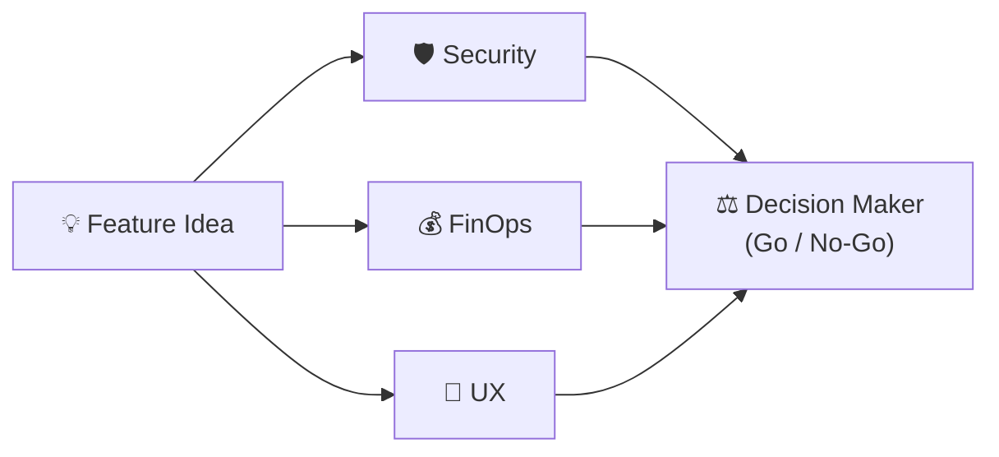

# 9.3 Parallel Agents

[🏠 Home](../../README.md) · [⬅ 9.2 Multi-Agent Relay](9_2_multi_agent.md) · [9.4 Human in the Loop (HITL) ➡](9_4_human_in_the_loop.md)

> **Module 9 · Simple Patterns** · 💻 Code: [9_3_parallel_agents.py](../../code/09-simple-patterns/9_3_parallel_agents.py)

## The problem

You're evaluating a new feature idea and want **3 independent expert opinions at once** (Security, Cost, UX) in parallel, followed by a single **Go / No-Go** summary.



## Run it

```powershell
.venv\Scripts\python code\09-simple-patterns\9_3_parallel_agents.py
```

## What you'll see

```text
Running 3 reviewers in parallel...
VERDICT: GO WITH CONDITIONS — ...
```

## Key takeaways

- Python's `asyncio.gather` + `agent.invoke_async()` runs independent Strands agents concurrently, cutting total wall-clock time to the slowest single reviewer.

---

[🏠 Home](../../README.md) · [⬅ 9.2 Multi-Agent Relay](9_2_multi_agent.md) · [9.4 Human in the Loop (HITL) ➡](9_4_human_in_the_loop.md)

