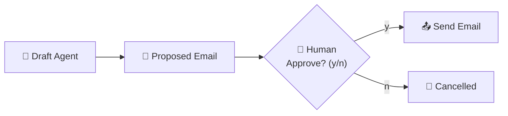

# 9.4 Human in the Loop (HITL)

[🏠 Home](../../README.md) · [⬅ 9.3 Parallel Agents](9_3_parallel_agents.md) · [9.5 Guardrails ➡](9_5_guardrails.md)

> **Module 9 · Simple Patterns** · 💻 Code: [9_4_human_in_the_loop.py](../../code/09-simple-patterns/9_4_human_in_the_loop.py)

## The problem

An agent drafts a refund/apology email to a VIP customer—but you **must not send it** until a human reviews and approves it.



## Run it

```powershell
.venv\Scripts\python code\09-simple-patterns\9_4_human_in_the_loop.py
```

## What you'll see

```text
--- DRAFT EMAIL ---
Subject: Update on your recent order...
Approve sending this email? [y/n]: y
✅ Email sent!
```

## Key takeaways

- For high-stakes actions (sending emails, issuing refunds, deleting data), separate **drafting** (AI) from **executing** (gated by human approval).

---

[🏠 Home](../../README.md) · [⬅ 9.3 Parallel Agents](9_3_parallel_agents.md) · [9.5 Guardrails ➡](9_5_guardrails.md)

