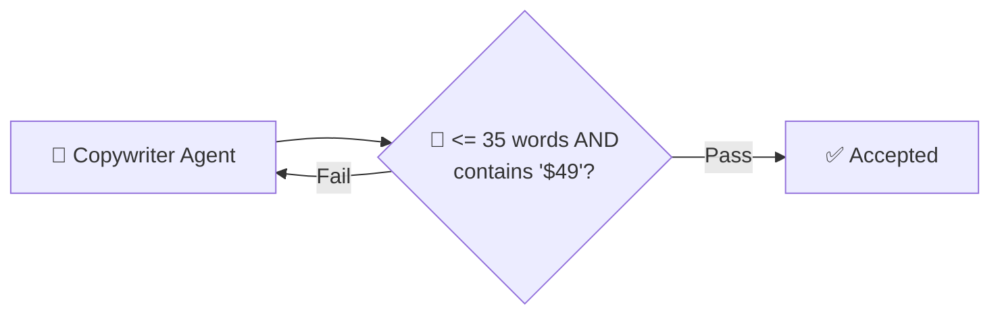

# 9.5 Guardrails

[🏠 Home](../../README.md) · [⬅ 9.4 Human in the Loop (HITL)](9_4_human_in_the_loop.md) · [🏠 Course Home ➡](../../README.md)

> **Module 9 · Simple Patterns** · 💻 Code: [9_5_guardrails.py](../../code/09-simple-patterns/9_5_guardrails.py)

## The problem

You want an agent to write a product blurb that **must** be under 35 words and **must** include the exact price (`$49`). If it fails either check, ask the agent to fix it automatically.



## Run it

```powershell
.venv\Scripts\python code\09-simple-patterns\9_5_guardrails.py
```

## What you'll see

```text
Attempt 1: Passed! (26 words, contains $49)
Final blurb: ...
```

## Key takeaways

- Deterministic Python checks + a 1–2 retry loop guarantee formatting and business rules 100% of the time.

---

[🏠 Home](../../README.md) · [⬅ 9.4 Human in the Loop (HITL)](9_4_human_in_the_loop.md) · [🏠 Course Home ➡](../../README.md)

